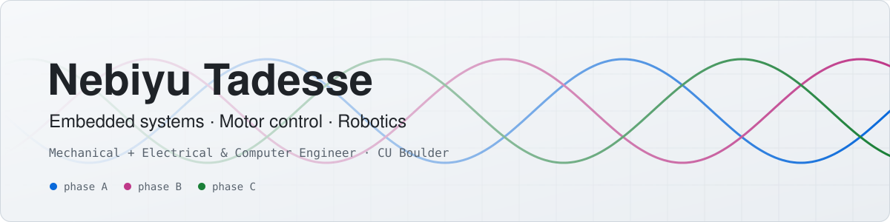
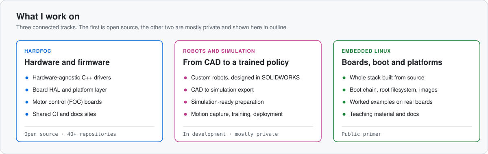
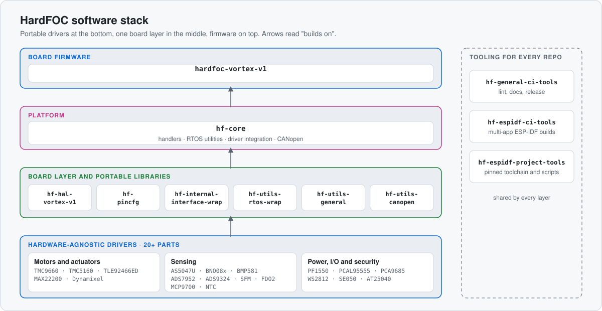
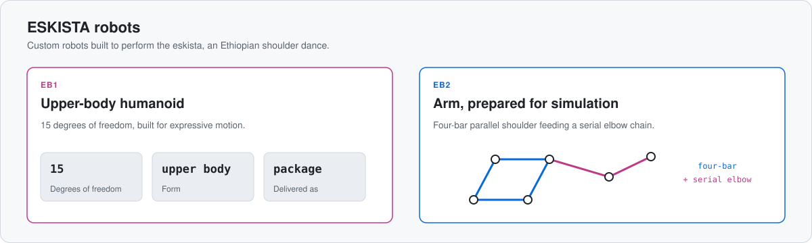
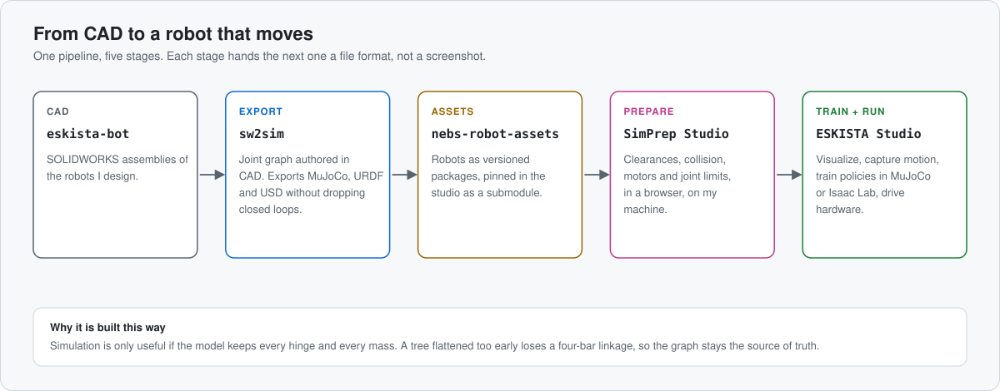
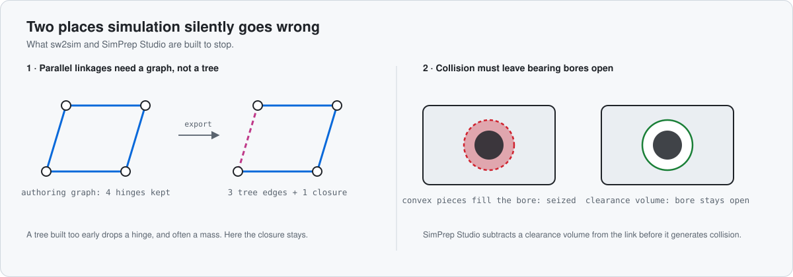

<picture>
  <source media="(prefers-color-scheme: dark)" srcset="assets/banner-dark.svg">
  
</picture>

I build robots and the embedded systems inside them. I hold two bachelor's degrees from the University of Colorado Boulder,
in mechanical engineering and in electrical and computer engineering, and a master's degree from Johns Hopkins University in
robotics and autonomous systems. That mix lets me work across the whole machine: the mechanism, the electronics, the firmware,
and the simulation that proves it before anything is built.

I like systems that are portable, testable and documented well enough that someone else can pick them up.

  <a href="#hardfoc"><b>HardFOC</b></a> ·
  <a href="#robots-and-simulation"><b>Robots and simulation</b></a> ·
  <a href="#embedded-linux"><b>Embedded Linux</b></a> ·
  <a href="#toolbox"><b>Toolbox</b></a>

<picture>
  <source media="(prefers-color-scheme: dark)" srcset="assets/overview-dark.svg">
  
</picture>

## HardFOC

[**HardFOC**](https://github.com/hardfoc) is the open-source organization I maintain for a hardware-based FOC (field-oriented control)
motor driver board and the software around it. It has 40+ public repositories, more than twenty of them drivers, and
most have their own documentation site.

<picture>
  <source media="(prefers-color-scheme: dark)" srcset="assets/hardfoc-stack-dark.svg">
  
</picture>

| Start here | What it is |
|:--|:--|
| [`hf-core`](https://github.com/hardfoc/hf-core) · [docs](https://hardfoc.github.io/hf-core/) | The shared platform layer: handlers, RTOS utilities, driver integration and CANopen, in C++20. |
| [`hardfoc-vortex-v1`](https://github.com/hardfoc/hardfoc-vortex-v1) | Firmware for the Vortex v1 controller board. |
| [`hf-tmc9660-driver`](https://github.com/hardfoc/hf-tmc9660-driver) · [docs](https://hardfoc.github.io/hf-tmc9660-driver/) | Hardware-agnostic driver for the TMC9660 motor controller. A good example of the driver pattern. |
| [`hf-tmc5160-driver`](https://github.com/hardfoc/hf-tmc5160-driver) · [docs](https://hardfoc.github.io/hf-tmc5160-driver/) | Hardware-agnostic driver for the TMC5160 stepper driver. |
| [`hf-internal-interface-wrap`](https://github.com/hardfoc/hf-internal-interface-wrap) · [docs](https://hardfoc.github.io/hf-internal-interface-wrap/) | The ESP-IDF wrappers that keep drivers free of platform code. |
| [`hf-general-ci-tools`](https://github.com/hardfoc/hf-general-ci-tools) · [docs](https://hardfoc.github.io/hf-general-ci-tools/) | Shared CI for the whole ecosystem. |
| [`hf-espidf-ci-tools`](https://github.com/hardfoc/hf-espidf-ci-tools) · [docs](https://hardfoc.github.io/hf-espidf-ci-tools/) | CI for ESP-IDF projects with one or many applications, driven by a YAML file. |

All repositories are on the [HardFOC organization page](https://github.com/hardfoc). Issues and discussions are welcome there.

## Robots and simulation

I design robots to perform the **eskista**, an Ethiopian shoulder dance, and I build the tools that take them from CAD to
a trained policy. This work is in development and the repositories are private, so this section shows how it fits together
rather than the code.

<picture>
  <source media="(prefers-color-scheme: dark)" srcset="assets/robots-dark.svg">
  
</picture>

<picture>
  <source media="(prefers-color-scheme: dark)" srcset="assets/pipeline-dark.svg">
  
</picture>

| Project | Status | What it does |
|:--|:--|:--|
| **sw2sim** | private, in development | A SOLIDWORKS add-in that keeps one canonical graph of links, frames and joints, and exports MuJoCo, URDF and USD without silently dropping parallel closures. |
| **SimPrep Studio** | private, in development | A browser tool, run locally, that makes a robot simulation-ready: carves bearing clearances, generates collision meshes, sets motors and joint limits, and runs training. |
| **ESKISTA Studio** | private, in development | A cross-platform desktop app that brings together robot visualization, motion capture, policy training and hardware control. |
| **Robot assets** | private | Versioned robot packages (EB1, EB2) that studios pin as a submodule, so a robot never changes under a consumer. |

Two problems drove the design of the first two tools:

<picture>
  <source media="(prefers-color-scheme: dark)" srcset="assets/mechanics-dark.svg">
  
</picture>

## Embedded Linux

[**`embedded-linux-primer`**](https://github.com/N3b3x/embedded-linux-primer) builds the whole software stack of an embedded Linux
board from source, one small board directory at a time, from the boot ROM to the root filesystem. It is public and aimed at
anyone who wants to understand what a distribution build tool does for them.

## Also public

| Repository | What it is |
|:--|:--|
| [`openballbot-rl`](https://github.com/N3b3x/openballbot-rl) | Fork of [salehiac/OpenBallBot-RL](https://github.com/salehiac/OpenBallBot-RL): a MuJoCo ballbot simulator with reinforcement-learning tools for uneven terrain. |
| [`EyeTrackerEmbed`](https://github.com/N3b3x/EyeTrackerEmbed) | Fork of [JEOresearch/EyeTracker](https://github.com/JEOresearch/EyeTracker): a lightweight Python eye tracker. |

## Toolbox

**Languages:** C and C++ (up to C++20), Python and Shell.
**Embedded:** ESP-IDF and RTOS portability layers, CANopen, peripheral drivers, and embedded Linux built from source.
**Robotics:** SOLIDWORKS, URDF and MJCF, MuJoCo, reinforcement-learning training, motion capture.
**Engineering practice:** GitHub Actions with reusable workflows, static analysis and linting in CI, generated documentation sites, and design notes kept next to the code.

Most of my work lives in private repositories, so the public profile is a small slice of it.
